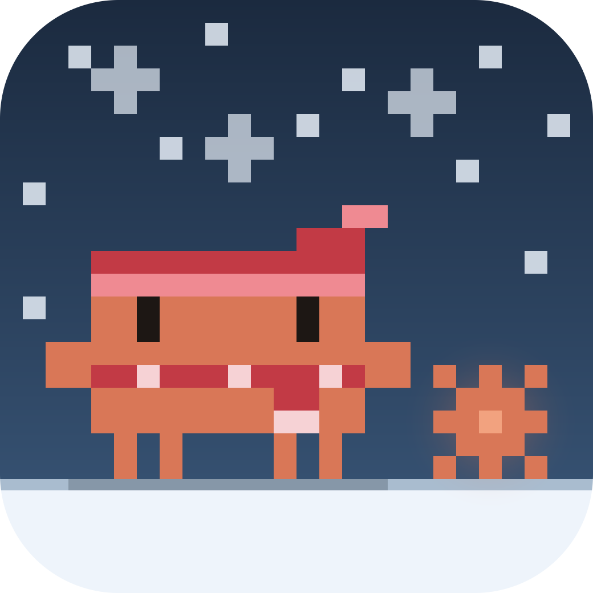

# Winter — a Claude Code mod



A winter look for Claude Code: snowy-day colors in light mode and winter-night colors in dark mode, a slow snowfall behind the conversation, and Claude's pixel character in a small band above the prompt.

[بالعربية ↓](#بالعربية)

- **Between turns** the character, in a knitted hat and a striped scarf, chases a small orange spark along a snowy track. A snowflake lands on the spark, which draws in, swells, and sneezes it off, spraying sparks at the character, who blinks. The character runs after the spark, puffs in the cold, pounces and misses while the spark darts home trailing sparks. While the character slides back across the ice with its arms out and waves to a snowman on the way, the spark dives into the snow and hides, stirring now and then, until it pops out as the character gets home. Together again, they play: a snowflake comes down onto the spark, which bounces it up off its top three times, higher each time, until the last bounce lands it on the character's hat, where it melts. Its footprints melt slowly in the snow.
- **When you send a prompt** it comes up out of the prompt box as a paper plane. The character catches it, unfolds it and reads it, then meets it by how it sounds, in English or in Arabic:
  - *thanks or praise* (thanks, great job, شكراً, ممتاز): it blushes and dances from side to side, a heart over its head;
  - *a hurry* (urgent, ASAP, عاجل, بسرعة): it starts with a `!` and a bead of sweat, and the whole band works faster for that turn, sweating on;
  - *a question*: it scratches its head under a `?` before it gets to work.
- **While Claude works** the character acts out what Claude is doing, and the spark whirls and glows beside it.
  - *Thinking or writing*: a laptop comes up out of the snow. The character types, stops to think (`...`) and glances at the spark. Now and then a robin comes down onto its hat.
  - *Editing files*: it types fast, and bits of code (`<>`) fly off the laptop to the spark, which whirls faster.
  - *Reading files*: it holds an open book, its eyes running along the lines, and turns a page now and then.
  - *Running a command*: it works the lever of a little terminal, whose screen scrolls at each pull.
  - *Searching the web*: it looks far out through binoculars, left, ahead and right.
  - Each act stays on for a moment at least, so a run of quick tools never flickers, and nothing cuts into the reading of your prompt.
- **The longer and harder Claude works, the hotter the spark**: it whirls faster and glows brighter after 20 seconds or 5 tools, and again after a minute or 15 tools, when it starts throwing off embers; after 3 minutes or 40 tools it blazes. A hard turn that ends with an answer ends in fireworks.
- **A long turn is a journey**: each minute, up to ten, the work camp (the character, its prop and the spark) packs up and walks on a step along the snow, and plants the minute's flag behind it, so you can count the minutes at a glance. On the way past the snowman it stops to wave, and the snowman waves back. The camp holds still while you are asked something, and makes up the minutes afterwards a station at a time, never skipping one. When the turn ends, the character meets it where the camp stands, plants a big flag with a gold star there if the turn was answered after two minutes or more, and runs home past its flags, the spark rolling beside it.
- **Git**: when a commit goes through, the character waves a green flag; when a push goes through, it throws a snowball up out of the band, and a star shines where it went. Claude's own commits and pushes count, and its agents' too.
- **When Claude needs your answer**, to a permission prompt, a question it asks you or a plan it puts to you, for itself or for one of its agents, the laptop shuts and the character raises its hand and waves, a `?` over its head, until you answer. The spark holds still and glows. A prompt that a rule or a hook settles before anyone is asked raises no hand.
- **For each agent Claude sends off**, a little helper in a colored hat comes out at the far end of the band, pacing with a parcel, and goes home when its agent is done. Up to three show at once.
- **When a turn ends** the laptop folds away. The character jumps for joy under a green tick when Claude has answered, wonders (`?`) when the turn ended without an answer, and just stands when you stopped it. Then the chase starts again.

- **The snow is a gauge of the conversation's context**: as the context fills, snow drifts up in banks along the band, a step deeper at 30%, 50%, 70% and 85%. When the conversation is compacted, the character takes up a shovel and clears it away.
- **A snowman built over days**: on the first day it is a snowball; each day you use Claude Code adds a part (its head, its face, its carrot, its stick arms that wave back, its top hat), and the answers add gifts (a scarf at 20, a broom at 60, a gold star on its hat at 150). It is kept across sessions.
- **Every move has its finish**: the pom-pom on the character's hat lags behind its moves, its body stretches as it springs up and squashes as it lands, and snow flies up about its feet.
- **Left alone a while, the band has a visitor**: two minutes into the chase, and every four minutes after, a little blue penguin waddles in from the far end, belly-slides across the ice and trades snowballs with the snowman before it waddles off. On a clear night a star shoots across the sky now and then, and every seven minutes or so the northern lights ripple over it for a while.
- **Point at the band** and everything holds still while the character waves, its eyes on your pointer: to the left of it, to the right, or right at you over its face. **Click it** and the character jumps, a heart over its head.
- **Late at night**, after midnight with nothing asked for a few minutes, the character settles down in the snow and dozes, z's over its head, until the next piece of work wakes it.
- **The sky follows your clock**: a moon and twinkling stars at night, a low sun at dawn and at dusk.
- **Occasions**: on New Year's Eve and New Year's Day the character wears a party hat under falling confetti. Through Ramadan, by the Umm al-Qura calendar, a lantern hangs over the band and a crescent stands in the sky.

The colors apply wherever Claude Code runs. The snowfall and the band are drawn in the Claude desktop app and the mobile app; a terminal draws no pictures, so there the mod brings the colors alone. The band runs the whole width the app gives it, up to 1200 pixels: the track, the snowman and the ice are laid out to fit it, and the character crosses a wider band faster.

## The /winter command

- `/winter calm` holds the band and the snow still, for when you want to focus.
- `/winter off` hides the band and holds the snow still.
- `/winter on` sets everything moving again.
- `/winter focus` starts a focus session of 25 minutes, or `/winter focus 50` of 50 (from 1 to 180). The character sits still in the snow with its eyes shut, and the spark's eleven rays go out one by one until the time is up. Then a bell rings over the spark, relit, and the character stands and stretches. Claude's work still shows on the band while it runs, and the session carries on after. `/winter focus stop` ends it early.
- `/winter sound on` plays a soft chime when Claude answers, a bell when a focus session ends, and a pop for a commit or a push; `/winter sound off` stops them. They are off until you turn them on, and the chime that answers `/winter sound on` says which player played it. They play on macOS, Windows and Linux alike, with the system's own player, the first that runs, and at the same loudness with each:
  - macOS: `afplay`, part of macOS.
  - Windows: .NET's SoundPlayer through PowerShell, both part of Windows, with no window. The sound's path reaches it in a variable, so a folder name with any character in it plays.
  - Linux: PipeWire's `pw-play`, PulseAudio's `paplay` or ALSA's `aplay`, which between them cover every desktop distribution; else `ffplay`, `mpv`, `gst-play-1.0`, `cvlc`, `play` or `canberra-gtk-play`. A Claude Code started outside the desktop session is pointed at the user's own sound server.
  - WSL: a Linux player if one is installed, else Windows' own, across the border.
  - With no player at all, the mod says what would play them, and looks again every ten minutes and at the next `/winter sound on`.
- `/winter` on its own says how it is set, and how long a focus session has left.

The settings are kept for your next sessions. The character moves a whole frame at a time on a pixel grid, the band holds still where the system asks for reduced motion, and each mood has its own description for screen readers, which also says how long a long turn has run and how many helpers are out.

## A quiet guest

- **It never gets in Claude's way.** Every hook that stands between Claude and its work (a tool, a permission prompt, a compaction) passes the event on as it came, and a slip in the band's own bookkeeping costs the band a beat, never Claude a tool. With no store to keep its settings in, it starts all the same.
- **It stays light.** The drawings it has made are kept while they are among the latest used, two dozen at most, so a long session holds no more memory than a short one.
- **It keeps to your machine.** It reads your prompt only to hear how it sounds, there and then, and keeps nothing of it. Its store holds three things: the `/winter` setting, whether the sounds are on, and the snowman's progress (how many days it has been built on, the last of them, and a count of answers). It makes no network requests, and the only programs it starts are a sound player, once you turn the sounds on, and `uname`, `id` and `wslpath` to find one.

## Install

At the prompt of a terminal session:

```
/plugin install winter --marketplace alnader5/claude-winter
```

Answer `y` to add the marketplace, then press Enter to install at the user scope, for every session from then on.

From a shell:

```
claude plugin install winter --marketplace alnader5/claude-winter
```

In the desktop app, where `/plugin` does not run: click **+** next to the prompt box, then **Plugins**, **Add marketplace** with `alnader5/claude-winter`, then **Add plugin**.

To take a newer version later:

```
claude plugin marketplace update claude-winter
claude plugin update winter
```

then start a new session.

## بالعربية

مود شتوي لـ Claude Code: ألوان يوم ثلجي في الوضع الفاتح وليلة شتوية في الوضع الداكن، وثلج يتساقط ببطء خلف المحادثة، وشخصية Claude البكسلية في شريط صغير فوق صندوق الكتابة.

### بين الأدوار

- تطارد الشخصية، بقبعتها الصوفية ووشاحها المخطط، شرارةً برتقالية صغيرة على طريق ثلجي. تسقط ندفة ثلج على الشرارة فتعطس وتطيّرها، فيتطاير الشرر على الشخصية فترمش.
- تركض الشخصية خلف الشرارة وتنفث بخار أنفاسها في البرد، ثم تنقضّ عليها فتفلت الشرارة عائدة إلى البيت تاركة أثراً من الشرر.
- في طريق العودة تنزلق الشخصية على الجليد بذراعين ممدودتين وتلوّح لرجل الثلج، بينما تغوص الشرارة في الثلج وتختبئ حتى تقفز منه فجأة عند وصولها.
- ثم يلعبان معاً: تسقط ندفة على الشرارة فتقذفها إلى أعلى ثلاث مرات، كل مرة أعلى من سابقتها، حتى تحطّ الأخيرة على قبعة الشخصية فتذوب. وتذوب آثار الأقدام في الثلج ببطء.

### حين ترسل رسالتك

تصعد رسالتك من صندوق الكتابة طائرةً ورقية، فتلتقطها الشخصية وتفتحها وتقرأها، ثم تتفاعل معها بحسب نبرتها، بالعربية أو بالإنجليزية:

- **الشكر أو الثناء** (شكراً، ممتاز، thanks): تحمرّ خجلاً وترقص يميناً ويساراً وفوقها قلب.
- **الاستعجال** (عاجل، بسرعة، ASAP): تنتفض بعلامة «!» وتتطاير منها قطرة عرق، ويعمل الشريط كله أسرع طوال ذلك الدور.
- **السؤال**: تحكّ رأسها تحت «؟» قبل أن تبدأ العمل.

### بينما يعمل Claude

تمثّل الشخصية ما يفعله Claude، والشرارة تدور وتتوهج بجانبها:

- **حين يفكّر أو يكتب**: يخرج حاسوب صغير من الثلج، فتكتب عليه وتتوقف لتفكّر «...» وتلقي نظرة على الشرارة، ويحطّ عصفور على قبعتها أحياناً.
- **حين يعدّل الملفات**: تكتب بسرعة وتطير رموز الشيفرة `<>` من حاسوبها إلى الشرارة فتدور أسرع.
- **حين يقرأ الملفات**: تمسك كتاباً مفتوحاً وعيناها تتبعان السطور، وتقلّب صفحاته.
- **حين يشغّل أمراً**: تشدّ ذراع طرفية صغيرة فتتمرر الأسطر على شاشتها.
- **حين يبحث في الويب**: تنظر بمنظارها بعيداً يساراً وأماماً ويميناً.
- يبقى كل مشهد لحظة على الأقل فلا يومض الشريط مع الأدوات السريعة، ولا يقطع شيءٌ قراءةَ رسالتك.

### حرارة العمل والرحلة

- كلما طال عمل Claude وكثرت أدواته ازدادت الشرارة حرارة: تدور أسرع وتتوهج أكثر بعد 20 ثانية أو 5 أدوات، ثم تتطاير منها الجمرات بعد دقيقة أو 15 أداة، وتتأجج بعد 3 دقائق أو 40 أداة. وإذا انتهى دور شاق بإجابة أطلقت ألعاباً نارية.
- **المهمة الطويلة رحلة**: كل دقيقة، حتى عشر دقائق، يحزم مخيّم العمل (الشخصية وأداتها والشرارة) أمتعته ويتقدّم خطوة على الثلج ويغرس راية الدقيقة خلفه، فتعدّ الدقائق بنظرة. وحين يمرّ برجل الثلج يتوقف ليلوّح له فيردّ التحية.
- يثبت المخيّم في مكانه ما دام Claude ينتظر جوابك، ثم يعوّض الدقائق بعدها محطةً محطة دون أن يتخطى واحدة.
- فإذا انتهت المهمة استقبلت الشخصية النهاية حيث يقف المخيّم، وغرست راية كبيرة بنجمة ذهبية إن انتهت بإجابة بعد دقيقتين أو أكثر، ثم ركضت عائدة إلى البيت بجانب راياتها والشرارة تتدحرج معها.

### Git والأسئلة والمساعدون

- عند كل commit ناجح تلوّح الشخصية براية خضراء، وعند كل push ترمي كرة ثلج إلى السماء فيلمع نجم مكانها، سواء أجراه Claude أم أحد وكلائه.
- **حين يحتاج Claude جوابك**، لطلب إذن أو لسؤال يطرحه عليك أو لخطة يعرضها، له أو لأحد وكلائه: تغلق الشخصية حاسوبها وترفع يدها ملوّحة وفوقها «؟» حتى تجيب، والشرارة ساكنة متوهجة. أما الإذن الذي تحسمه قاعدة أو hook قبل أن يُسأل أحد فلا ترتفع له يد.
- لكل وكيل يرسله Claude يظهر مساعد صغير بقبعة ملونة في آخر الشريط يحمل طرداً ذهاباً وإياباً، ويعود حين ينتهي وكيله، وأقصى عدد يظهر ثلاثة معاً.
- وحين ينتهي الدور يُطوى الحاسوب: تقفز الشخصية فرحاً تحت علامة ✓ خضراء إن وصل الرد، وتتساءل «؟» إن انتهى بلا رد، وتقف ساكنة إن أوقفته أنت. ثم تبدأ المطاردة من جديد.

### الثلج ورجل الثلج واللمسات

- **الثلج مقياس لسياق المحادثة**: كلما امتلأ السياق تراكم الثلج أكواماً على امتداد الشريط، بدرجة أعمق عند 30% و50% و70% و85%. فإذا ضُغطت المحادثة حملت الشخصية مجرفة وأزاحته.
- **رجل ثلج يُبنى على مدى الأيام**: في اليوم الأول كرة ثلج، ثم يُضاف إليه كل يوم تستخدم فيه Claude Code جزءٌ جديد (رأسه، فوجهه، فجزرته، فذراعاه اللتان تلوّحان، فقبعته)، وتمنحه الإجابات هدايا: وشاحاً عند 20 إجابة، ومكنسة عند 60، ونجمة ذهبية على قبعته عند 150. ويبقى محفوظاً بين الجلسات.
- **لكل حركة لمستها**: تتأخر كرة القبعة خلف حركة الشخصية، ويتمطّى جسمها حين تقفز وينضغط حين تهبط، ويتطاير الثلج حول قدميها.
- **زائر حين يُترك الشريط لحاله**: بعد دقيقتين من المطاردة، ثم كل أربع دقائق، يأتي بطريق أزرق صغير يتهادى ثم ينزلق على بطنه فوق الجليد ويتراشق بكرات الثلج مع رجل الثلج ثم يمضي. وفي الليالي الصافية يعبر السماءَ شهابٌ بين حين وآخر، ويتماوج الشفق القطبي فوقها كل سبع دقائق تقريباً.
- **مرّر الفأرة فوق الشريط** فيتوقف كل شيء وتلوّح الشخصية وعيناها تتبعان مؤشرك يميناً أو يساراً أو تنظر إليك مباشرة، **وانقر عليه** فتقفز ويظهر فوقها قلب.
- **في آخر الليل**، بعد منتصف الليل إن لم تطلب شيئاً لبضع دقائق، تجلس الشخصية في الثلج وتغفو وفوقها «Zzz» حتى يوقظها العمل التالي.
- **السماء تتبع ساعتك**: قمر ونجوم ليلاً، وشمس منخفضة عند الشروق والغروب.
- **المناسبات**: في ليلة رأس السنة ويومها تلبس الشخصية قبعة احتفال تحت قصاصات ملونة، وفي رمضان، بحسب تقويم أم القرى، يتدلى فانوس فوق الشريط ويظهر هلال في السماء.

تظهر الألوان أينما عمل Claude Code. أما الثلج والشريط فيُرسمان في تطبيق سطح المكتب وتطبيق الجوال، ولا ترسم الطرفية صوراً، فيقتصر المود فيها على الألوان. ويمتد الشريط بعرض المساحة كلها حتى 1200 بكسل، فيتوزع الطريق ورجل الثلج والجليد على العرض، وتقطعه الشخصية أسرع كلما اتسع.

### الأمر ‎/winter

- `/winter calm` يوقف حركة الشريط والثلج حين تريد التركيز.
- `/winter off` يخفي الشريط ويوقف الثلج.
- `/winter on` يعيد الحركة لكل شيء.
- `/winter focus` يبدأ جلسة تركيز مدتها 25 دقيقة، أو `/winter focus 50` لخمسين دقيقة (من 1 إلى 180). تجلس الشخصية في الثلج مغمضة العينين وتنطفئ أشعة الشرارة الإحدى عشرة واحداً تلو الآخر حتى ينتهي الوقت، ثم يرنّ جرس فوق الشرارة وتنهض الشخصية وتتمطّى. ويظل عمل Claude يظهر على الشريط أثناءها، وتستمر الجلسة بعده. و`/winter focus stop` ينهيها مبكراً.
- `/winter sound on` يشغّل الأصوات: رنّة حين يجيب Claude، وجرس عند نهاية جلسة التركيز، ونقرة لكل commit أو push، و`/winter sound off` يوقفها. وهي متوقفة حتى تشغّلها، وتخبرك رسالة الأمر بالمشغّل الذي عزف الرنّة. تعمل على الأنظمة كلها بمشغّل النظام نفسه وبالارتفاع ذاته:
  - macOS: ‏`afplay` المدمج في النظام.
  - Windows: ‏SoundPlayer عبر PowerShell، وكلاهما مدمج في Windows، دون أي نافذة.
  - Linux: ‏`pw-play` أو `paplay` أو `aplay` التي تغطي توزيعات سطح المكتب كلها، ثم `ffplay` و`mpv` و`gst-play-1.0` وغيرها إن لم توجد.
  - WSL: مشغّل Linux إن وُجد، وإلا مشغّل Windows نفسه.
  - وإن لم يوجد أي مشغّل أخبرتك الرسالة بما يلزم، وأعاد المود البحث كل عشر دقائق وعند `/winter sound on` التالي.
- `/winter` وحده يخبرك بالإعداد الحالي وبما بقي من جلسة التركيز.

تبقى إعداداتك محفوظة لجلساتك القادمة. وتتحرك الشخصية إطاراً كاملاً في كل مرة على شبكة بكسلات، ويثبت الشريط حين يطلب النظام تقليل الحركة، ولكل حالة وصفها الخاص لقارئات الشاشة، يذكر أيضاً كم مضى من المهمة الطويلة وكم مساعداً يعمل.

### ضيف هادئ

- **لا يعترض عمل Claude أبداً**: كل ما يقف بين Claude وعمله (أداة، طلب إذن، ضغط المحادثة) يمرّ كما جاء، وأي تعثّر في حسابات الشريط يكلّف الشريط لحظة، ولا يكلّف Claude أداة. وإن لم يوجد مخزن لحفظ الإعدادات بدأ المود كالمعتاد.
- **خفيف**: يحتفظ بآخر الرسومات المستعملة فقط، أربعاً وعشرين على الأكثر، فلا تستهلك الجلسة الطويلة ذاكرة أكثر من القصيرة.
- **يبقى على جهازك**: يقرأ رسالتك فقط ليعرف نبرتها في لحظتها، ولا يحفظ منها شيئاً. ويحفظ في مخزنه ثلاثة أشياء فقط: إعداد `/winter`، وتشغيل الأصوات من عدمه، وتقدّم رجل الثلج (عدد أيام بنائه وآخرها وعدد الإجابات). لا يتصل بالشبكة إطلاقاً، ولا يشغّل من البرامج إلا مشغّل الصوت بعد أن تفعّل الأصوات، و`uname` و`id` و`wslpath` للعثور عليه.

### التثبيت

اكتب في Claude Code داخل الطرفية:

```
/plugin install winter --marketplace alnader5/claude-winter
```

ثم اضغط `y` لإضافة السوق، وEnter للتثبيت في كل جلساتك. وفي تطبيق سطح المكتب: اضغط **+** بجانب صندوق الكتابة، ثم **Plugins**، ثم **Add marketplace** واكتب `alnader5/claude-winter`، ثم **Add plugin**.

ولأخذ نسخة أحدث لاحقاً:

```
claude plugin marketplace update claude-winter
claude plugin update winter
```

ثم ابدأ جلسة جديدة.

## Development

- `hooks/register.tsx`: the hooks. The look at the session's start, the backdrop, the band, and the turn events the band follows.
- `hooks/band.ts` and `hooks/sprite.ts`: the band's reels, one per mood and one per kind of work, and the pixel sprite they are drawn from.
- `hooks/drawings.ts`: the drawings kept while they are among the latest used.
- `hooks/markup.ts`: what the band's drawing and the backdrop's share as markup.
- `hooks/work.ts`: what the character acts out for each tool, and the band's words for screen readers while Claude works.
- `hooks/tone.ts`: how a prompt sounds (thanks, a hurry, a question), read in English and in Arabic.
- `hooks/git.ts`: which shell commands commit or push, for the band to cheer.
- `hooks/snowman.ts`: the snowman's build over days, kept in the mod's store.
- `sounds/`: the chime, the bell and the pop, made from sine waves by `node tools/make-sounds.mjs` as 16-bit mono WAV, the one format every system's player reads, at the loudness they play at.
- `hooks/sound.ts`: which player plays them on each system, found by trying each in turn, with no shell.
- `hooks/scene.ts`: the snowfall backdrop and its skies.
- `hooks/time.ts`: the sky, the occasion and the lateness, read from this machine's clock; Ramadan by the Umm al-Qura calendar.
- `hooks/palette.ts`: the winter colors, generated by `node tools/make-palette.mjs`.
- `.claude-plugin/icon.png`: the mod's icon, drawn from the band's own sprite by `node tools/make-icon.mjs`.
- `tests/winter.test.tsx`: run with `claude plugin test .`. Check the whole mod with `claude plugin validate .`.

## License

MIT, for everything here except `hooks/make-colors.js` and `hooks/make-colors.d.ts`. Those two come unchanged from Claude Code's mod-authoring kit, which has every mod carry them, and are not covered by this repository's license.
